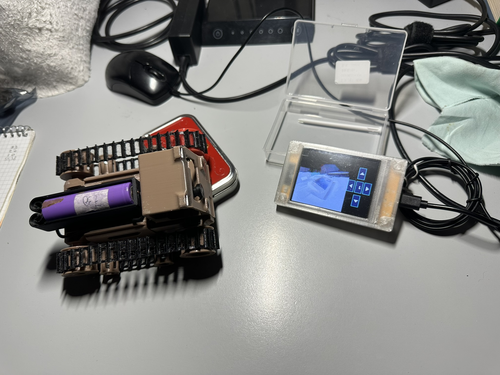

# Scout32 CYD Remote Controller

A dedicated handheld touchscreen controller for the **Scout32 WiFi FPV Camera Rover**, built using the **Cheap Yellow Display (CYD)** (ESP32-2432S028R).



## 📌 Project Overview

Driven by curiosity to replace a smartphone or PC web browser with a standalone physical controller, this project provides a custom firmware for the **CYD (ESP32-2432S028R)** board. It connects directly to the Scout32 rover's Access Point, decodes the live FPV JPEG video stream on-the-fly, and provides responsive directional and light controls via the integrated touchscreen.

* **3D Printed Rover Model:** [Scout32 ESP32 WiFi FPV Camera Rover on Printables](https://www.printables.com/model/328436-scout32-esp32-wifi-fpv-camera-rover)
* **Development Environment:** VS Code with PlatformIO

---

## ✨ Features

* **Direct Wi-Fi Streaming:** Connects automatically to the `Scout32` Wi-Fi Access Point.
* **Low-Latency JPEG Video Decoding:** Fast frame rendering using the `JPEGDEC` library with fast block transfer (`pushImage`).
* **Software Contrast & Gamma Correction:** Real-time color tone mapping on RGB565 pixels to avoid overexposed whites and restore lost gray details on TFT panels.
* **Touch Control Interface:** On-screen controls for Forward, Backward, Left, Right, and Flashlight Toggle.
* **Stand-Alone Operation:** Eliminates the need for a secondary mobile device or laptop to pilot the rover.

---

## 🛠️ Hardware Requirements

* **Cheap Yellow Display (CYD)** — ESP32 Development Board with 2.8" TFT (ILI9341) & Touchscreen (XPT2046).
* **Scout32 FPV Rover** (ESP32-CAM based vehicle).
* USB Cable for power and programming.

---

## 💻 Software & Libraries

This project is built using **PlatformIO** inside **Visual Studio Code**. The required libraries are managed automatically via `platformio.ini`:

* [TFT_eSPI](https://github.com/Bodmer/TFT_eSPI) — Display rendering library configured specifically for CYD via build flags.
* [XPT2046_Touchscreen](https://github.com/PaulStoffregen/XPT2046_Touchscreen) — Touchpanel SPI library.
* [JPEGDEC](https://github.com/bitbank2/JPEGDEC) — Optimized C JPEG decoder.

---

## 🚀 Getting Started

1. **Clone the Repository:**
   ```bash
   git clone https://github.com/your-username/scout32-cyd-controller.git
   cd scout32-cyd-controller
   ```

2. **Open in VS Code:**
   Open the repository folder with Visual Studio Code (make sure the **PlatformIO IDE** extension is installed).

3. **Build & Upload:**
   * Connect your CYD board via USB.
   * Click the **PlatformIO: Build** button (check icon) to compile.
   * Click **PlatformIO: Upload** (arrow icon) to flash the firmware to your board.

4. **Connect & Play:**
   * Turn on the Scout32 FPV Rover.
   * Power on the CYD board; it will connect to the `Scout32` Access Point and begin streaming live video with interactive touchscreen controls.

---

## 🔮 Future Improvements

This project is a solid baseline and can be further extended:
* Adding dynamic Wi-Fi credential configuration (e.g., WiFiManager).
* Battery status indicator / voltage monitoring overlay.
* Dual-stick or analog virtual joystick controls.

---

## 📜 License & Credits

* **Author:** Open source community contribution.
* **Original Rover Design:** [Scout32 Model by CSG_3D](https://www.printables.com/model/328436-scout32-esp32-wifi-fpv-camera-rover).

*Have fun driving! 🚗💨*
